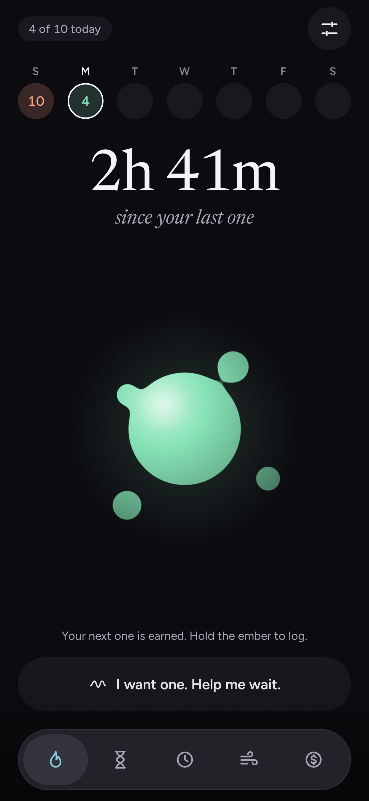
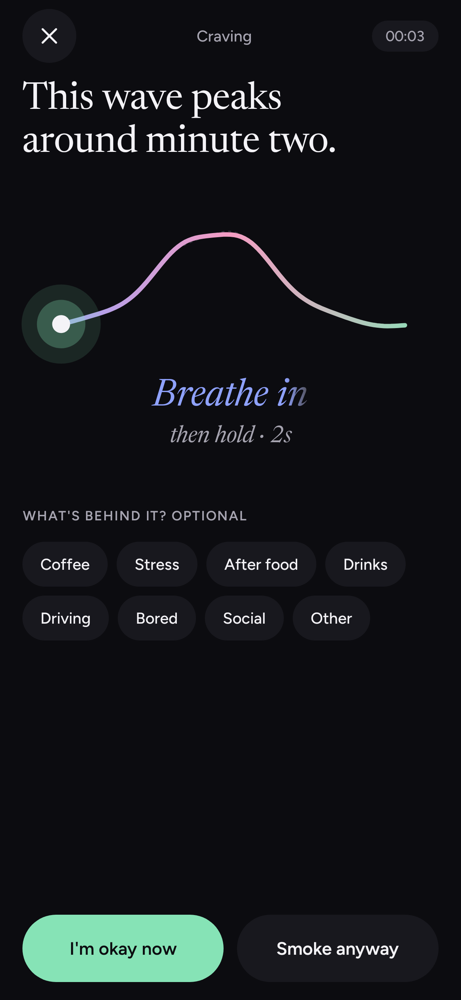
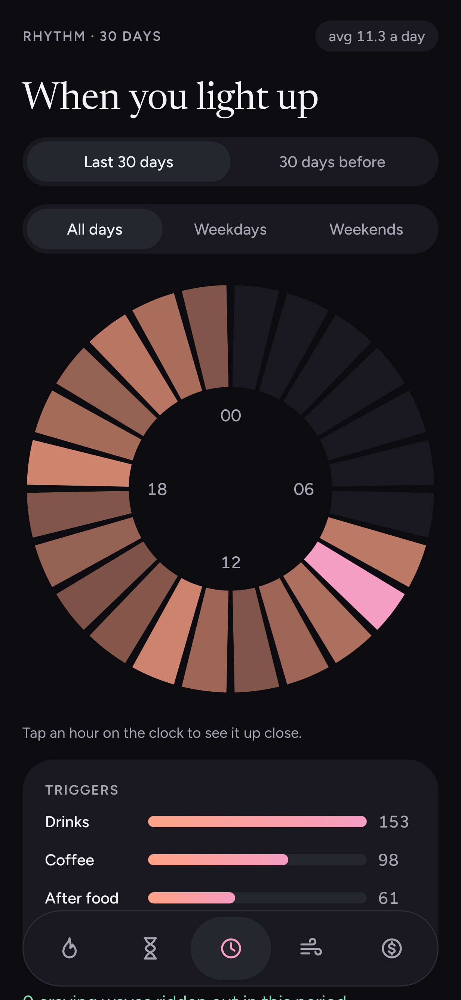
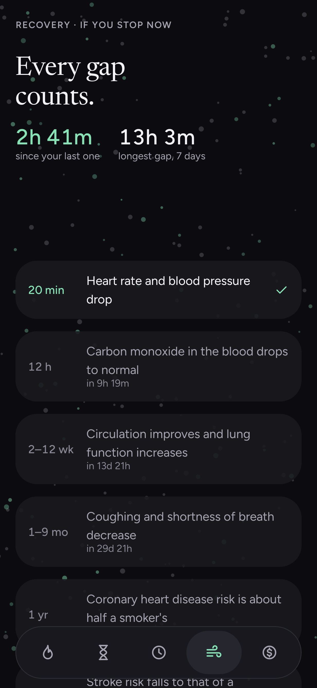
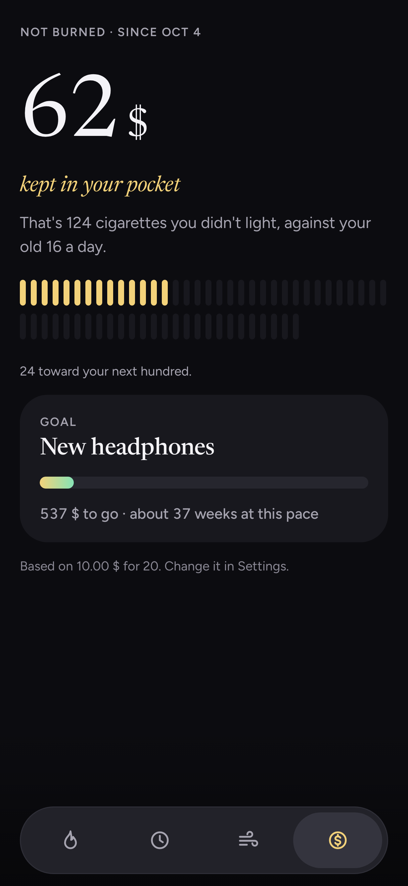
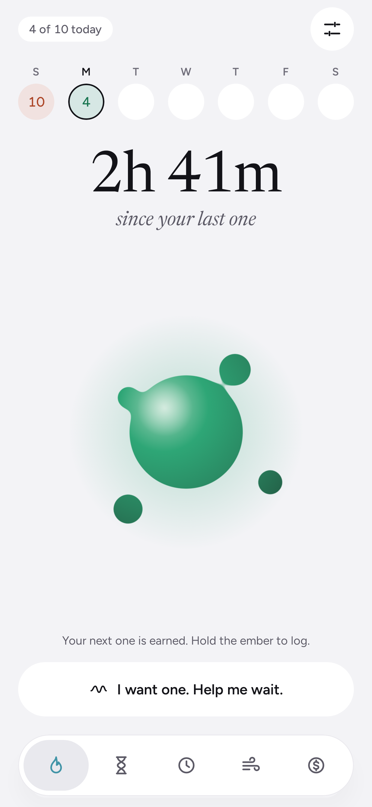
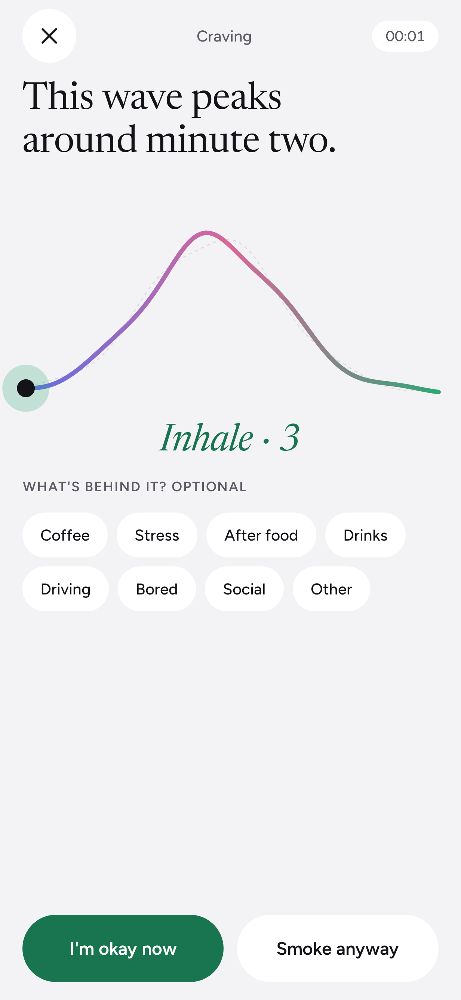
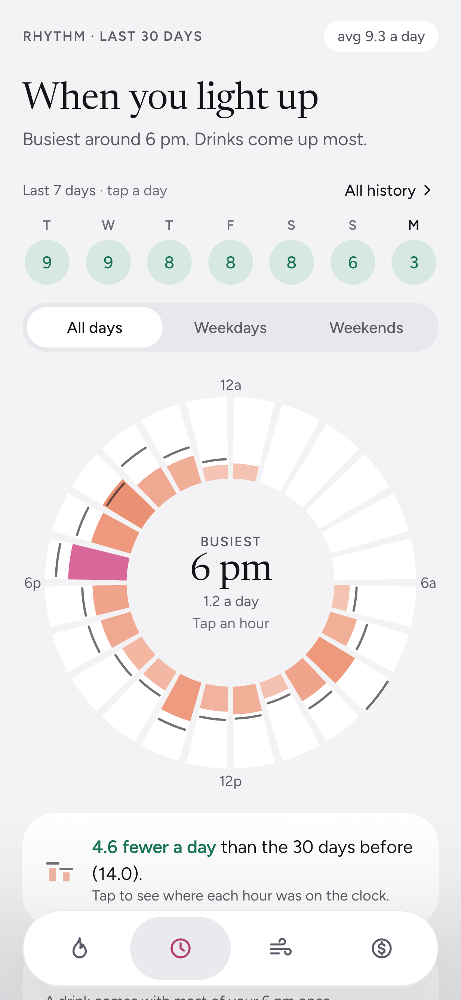
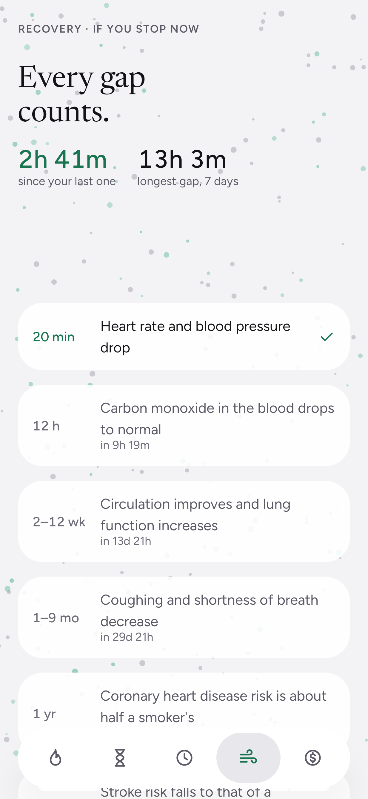
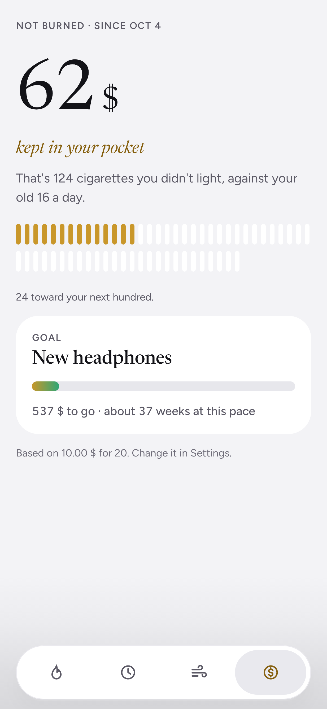

# Exhale

Android app to track, regulate and cut down cigarette consumption. Built with Jetpack Compose.
All data stays on the device.

**Burn less. Exhale more.** Everything about smoking is shown warm; everything about recovery is shown cool.
As you cut down, the app literally cools.

| | Ember | Urge Wave | Rhythm | Air | Money |
|---|---|---|---|---|---|
| Dark |  |  |  |  |  |
| Light |  |  |  |  |  |

## Features (prototype v0.1)
- **Ember** — home: a molten ember with orbiting droplets inside a countdown ring. Hold it 1.5 s to log; a hint under it reacts to the gesture.
- **Countdown ring** around the ember — the gap to your next one under a tapering daily allowance. Going over borrows from tomorrow.
- **Urge Wave** — ride a 4-minute craving wave with paced breathing and haptics.
- **Rhythm** — when you smoke: the last 7 days (tap one to filter), a 24-hour clock compared with the 30 days before, an if-then plan for your busiest hour, and triggers.
- **History** — every day so far as a calendar, from Rhythm's "All history".
- **Air** — WHO recovery milestones over a particle field that clears.
- **Money** — money not burned vs. your old baseline, with a savings goal.
- **Quick-settings tile** — log without opening the app.
- **Export and import CSV** — every cigarette and craving wave in a spreadsheet file, saved where you choose; importing one adds what isn't in the app yet (Settings → Your data).
- Step-by-step onboarding: habit, cost, plan, optional goal.
- Dark and light themes (follows the phone, override in Settings).
- Floating tab bar, big pill buttons, Newsreader + Figtree type.
- Design system and live UI kit (Settings → Prototype tools → Design system, debug builds only).
- Demo data loader in Settings for trying every screen.

## Install on a phone
Open the latest release on your phone: https://github.com/diyazsjak/exhale-mobile/releases/latest
Download `exhale-<version>.apk` and open it. Android asks once to allow installs from your browser.
New versions install over the old one and keep your data.

## Publish a new version
1. Change `versionName` in [`version.properties`](version.properties), e.g. `0.1.0` → `0.2.0`.
2. Push to `main`.

GitHub Actions ([`release.yml`](.github/workflows/release.yml)) runs the tests, builds the APK and creates release `v<versionName>`.
Pushes that don't change the version don't publish anything. A version that's already released is never rebuilt.

## Build
Requires JDK 17+ and the Android SDK (platform 36).

```bash
./gradlew assembleDebug
```

APK: `app/build/outputs/apk/debug/app-debug.apk`

```bash
./gradlew testDebugUnitTest
```

```bash
./gradlew recordRoborazziDebug
```

## Docs
- [`docs/SPEC.md`](docs/SPEC.md) — product, domain rules, architecture, roadmap.
- [`docs/DESIGN-SYSTEM.md`](docs/DESIGN-SYSTEM.md) — colours, type, components and usage rules.
- [`CLAUDE.md`](CLAUDE.md) / `AGENTS.md` — rules for AI coding agents.

Health facts: WHO, *Health benefits of smoking cessation*; Lindson et al., Cochrane Review 2019.
Exhale is not medical advice.

Fonts (Newsreader, Figtree) are under the SIL Open Font License, see `docs/fonts/`.
