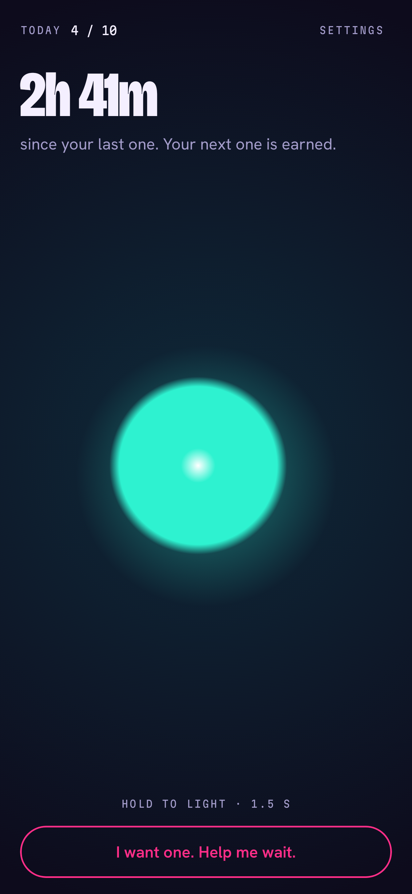
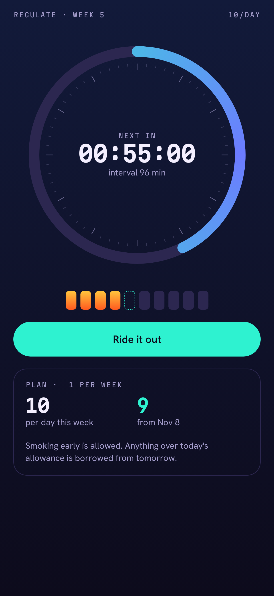
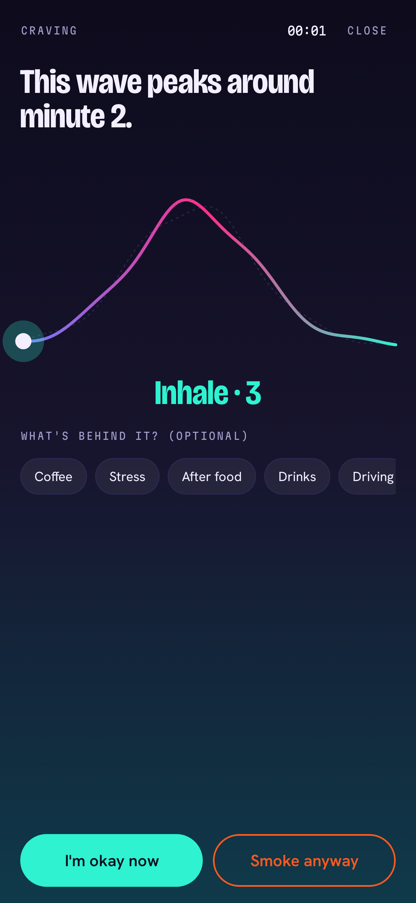
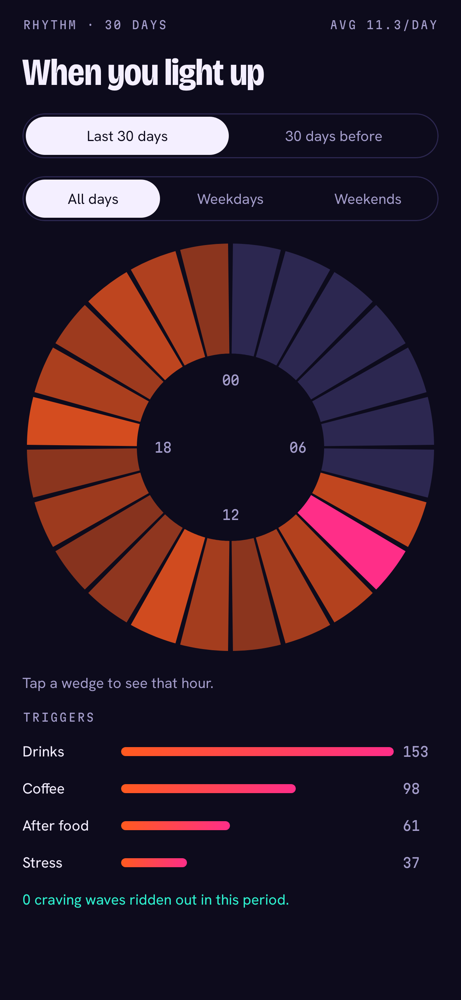
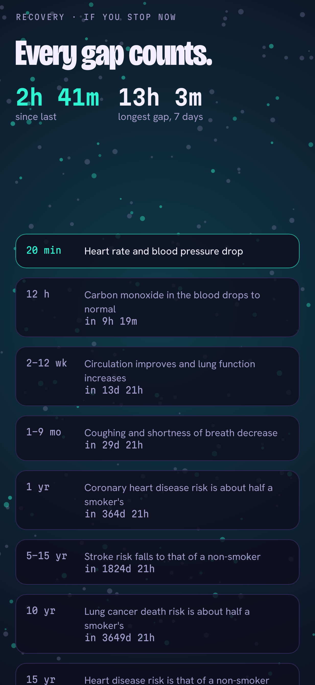
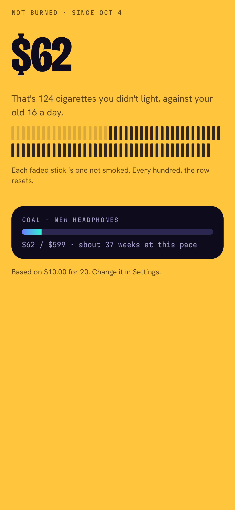

# Exhale

Android app to track, regulate and cut down cigarette consumption. Built with Jetpack Compose.
All data stays on the device.

**Burn less. Exhale more.** Everything about smoking is shown warm; everything about recovery is shown cool.
As you cut down, the app literally cools.

| Ember | Regulate | Urge Wave | Rhythm | Air | Money |
|---|---|---|---|---|---|
|  |  |  |  |  |  |

## Features (prototype v0.1)
- **Ember** — home orb that cools as time since your last cigarette grows. Press and hold 1.5 s to log, then undo or tag a trigger.
- **Regulate** — tapering daily allowance and interval ring. Going over borrows from tomorrow.
- **Urge Wave** — ride a 4-minute craving wave with paced breathing and haptics.
- **Rhythm** — 24-hour radial heatmap of when you smoke, plus triggers.
- **Air** — WHO recovery milestones over a particle field that clears.
- **Money** — money not burned vs. your old baseline, with a savings goal.
- **Quick-settings tile** — log without opening the app.
- Step-by-step onboarding: habit, cost, plan, optional goal.
- Demo data loader in Settings for trying every screen.

## Build
Requires JDK 17+ and the Android SDK (platform 36).

```bash
./gradlew assembleDebug
```

APK: `app/build/outputs/apk/debug/app-debug.apk`

```bash
./gradlew testDebugUnitTest
```

```bash
./gradlew recordRoborazziDebug
```

## Docs
- [`docs/SPEC.md`](docs/SPEC.md) — product, design language, domain rules, architecture, roadmap.
- [`CLAUDE.md`](CLAUDE.md) / `AGENTS.md` — rules for AI coding agents.

Health facts: WHO, *Health benefits of smoking cessation*; Lindson et al., Cochrane Review 2019.
Exhale is not medical advice.

Fonts (Bricolage Grotesque, Hanken Grotesk, Martian Mono) are under the SIL Open Font License, see `docs/FONTS-OFL.txt`.
